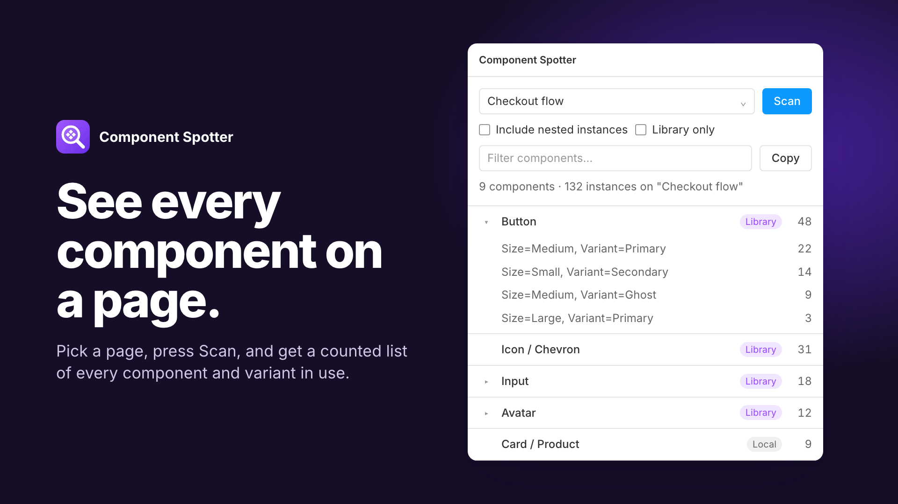

# Component Spotter

A Figma plugin that lists every component used on a page, counted and grouped by variant.



## Features

- **Counted list** — one row per component or component set, with the number of instances on the page.
- **Variant breakdown** — expand a component set to see which variants are used and how often.
- **Library, local or missing** — badges show where each component comes from; instances whose main component was deleted are grouped under *Missing component*.
- **Library only** — hide local components to check how much of a page uses your design system.
- **Nested instances** — optionally count components inside other components (e.g. icons inside buttons).
- **Select on canvas** — click a component or variant to select every matching instance and zoom to it.
- **Filter and copy** — search the list, or copy it as plain text.

## Usage

1. Open the plugin in a Figma design file.
2. Pick a page (defaults to the current one).
3. Press **Scan**.

## Privacy

The plugin makes no network requests (`networkAccess.allowedDomains: ["none"]`), stores no data, and uses no analytics. It only reads the scanned page in memory.

## Development

No build step — the plugin is plain JavaScript.

| File | Purpose |
|---|---|
| `manifest.json` | Plugin manifest |
| `code.js` | Main thread: scans the page, groups instances, handles selection |
| `ui.html` | Plugin UI |
| `publish/` | Community listing copy (`LISTING.md`) and images |

To run locally: in Figma desktop, go to **Plugins → Development → Import plugin from manifest…** and pick `manifest.json`.

### Listing images

Listing images are rendered from `publish/src/*.html` with headless Google Chrome:

```sh
./publish/render.sh
```
